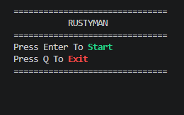
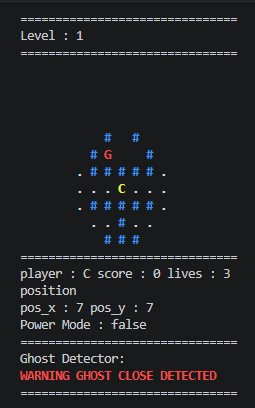
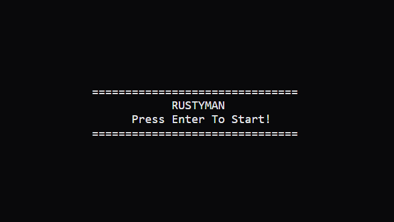
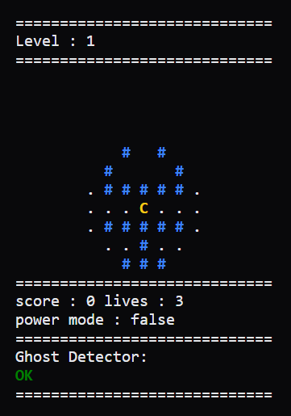

# RustyMan


---
## About
it is a terminal based game and inspired by pacman.

you are the player (which is a `'C'` char) collecting dots accros the map.

you have *limited view,* so be carefull of the ghost `'G'`, boo!

also you can have temporary **full view** by eating **power pallete!** you can **eat ghost** with power mode!


## SneakPeek
### Terminal
---
| Main Menu | Gameplay |
| :---: | :---: |
|||

### Website
---
| Main Menu | Gameplay |
| :---: | :---: |
||  |

   

## Tech Stack
using :
- Rust
- WASM
- Javascript
- HTML, and CSS

## How its been made
its sucks, but i love it. like my back never has been soo sore for a project.

and the WASM, its hard, like suddenly my love rust complier cant tell me whats the eror, i literally have to do `cargo check`, and know what ive been missing.

but i think its worth, i learn alot about low level programming, ts is tuff.

## Installation
### Run it in Terminal
Open your desired Terminal.
```bash
git clone https://github.com/whyfren/RustyMan.git
cd RustyMan
cargo run
```

---
### Run it in Website
Open your desired Terminal.
```bash
git clone https://github.com/whyfren/RustyMan.git
cd RustyMan
cargo install
wasm-pack build --target web
npx serve .
xdg-open http://localhost:3000/
```
---

## Play
> [!TIP]
> Play directly in your browser: **[Play RustyMan Live](https://whyfren.github.io/RustyMan/)**

or **if you want** to run it **in local,** check installation guide!


feel free to check it out!

### input keys

| Key | Action |
| :---: | :--- |
|W|Up|
|A|Left|
|S|Down|
|D|Right|
|Q|Quit|
|Enter|select|

## Roadmap

Check out what we developed or upcoming features in [PROGRESS.md](docs/PROGRESS.md)!


## what ai used for?

**debugging,** idk what else. like literally if i stuck, i use AI.

how much?

it helped a lot for spotting bug,

logical eror,

or just a silly bug.

but **rust complier** itself can **handle at mosts things,** thats why i l love this language, rusty rusty